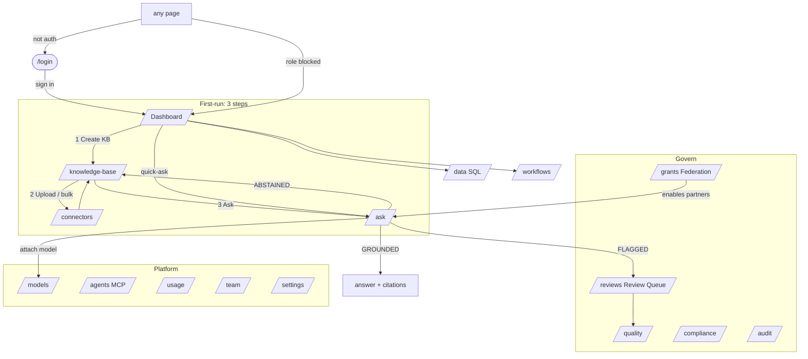

# RAG as a Service Console — User Flow (SLD)

A single-line-diagram-style walkthrough of the console: which page a user lands on, where each
page leads, and why. Use it to onboard teammates or explain the product journey.

> **The one-sentence journey:** *Log in → set up a Knowledge Base → add documents → Ask a
> question → get a cited answer (or an honest abstain).* Everything else (Govern, Platform) is
> the loop that keeps that answer trustworthy and the platform running.

---

## 0. Legend

- **`/route`** = the page's URL.
- **Roles** = who can see the page (`reader`, `ingestor`, `reviewer`, `admin`). A user only
  sees nav items their role allows; visiting a page you can't see **redirects to Dashboard**.
- **→** = a real in-app link/redirect (from the code), not just "you could click the nav".

---

## 1. Entry — authentication

```
[ /login ] --sign in--> [ / Dashboard ]
   ^                         |
   |   (not authenticated)   |  (already signed in, visiting /login)
   +----- any page ----------+  --> redirects back to /
```

- First-time users may be sent to **`/set-password`** (invite / reset) → then `/login` → `/`.
- Sign out (top bar) → `/login`.

---

## 2. THE PRIMARY FLOW — new user to first grounded answer

The Dashboard shows a **3-step onboarding checklist** (auto-hides once complete). This IS the
intended first path:

```
[ / Dashboard ]
   │  onboarding step 1  "Create a KB"
   ▼
[ /knowledge-base ]  ── create a Knowledge Base ─────────────┐
   │  onboarding step 2  "Upload"  (enabled once a KB exists) │
   ▼                                                          │
[ /knowledge-base (upload) ]  OR  [ /connectors (bulk/web) ]  │  add documents
   │  onboarding step 3  "Go to Ask"  (enabled once docs > 0) │
   ▼                                                          │
[ /ask ]  ── ask a question ──> ANSWER                        │
   │                                                          │
   ├─ GROUNDED  → answer + citations (click a citation → source viewer)
   ├─ FLAGGED   → "Held for human review" → [ /reviews ]  (a human decides)
   └─ ABSTAINED → "not enough evidence" → add more docs ([ /knowledge-base ])
```

**Step-by-step, with purpose:**

| # | Page | What the user does | Why | Leads to |
|---|------|--------------------|-----|----------|
| 1 | **`/` Dashboard** | See KPIs + onboarding checklist; can also type a question in the quick-ask box | Orientation / starting point | `/ask?q=…`, `/knowledge-base`, `/reviews` |
| 2 | **`/knowledge-base`** Knowledge Bases | Create a KB (a named document collection); upload documents | A KB is the unit you ask questions against | `/connectors`, `/ask` |
| 3 | **`/connectors`** Connectors | Pull documents in bulk — object store, external bucket, or crawl a website | Scale ingestion beyond single-file upload | back to `/knowledge-base` |
| 4 | **`/ask`** Ask | Ask a question; read the grounded answer + citations; follow-up chips | The core value: cited, trustworthy answers | citation viewer, `/reviews`, `/models` |

---

## 3. Full page map by section

### Overview
| Page | Route | Roles | Purpose | Outbound links |
|---|---|---|---|---|
| **Dashboard** | `/` | all | Landing page: document/review/satisfaction KPIs, onboarding checklist, quick-ask box | → `/ask`, `/knowledge-base`, `/reviews` |

### Knowledge — *get documents in*
| Page | Route | Roles | Purpose | Outbound links |
|---|---|---|---|---|
| **Knowledge Bases** | `/knowledge-base` | ingestor, admin | Create/select KBs; upload docs; per-KB settings (attached model, chat widget, bot, taxonomy, knowledge graph) | → `/ask` |
| **Connectors** | `/connectors` | ingestor, admin | Bulk ingest: object-store pull, external tenant bucket, website crawl | → `/knowledge-base` |

### Answer — *get answers out*
| Page | Route | Roles | Purpose | Outbound links |
|---|---|---|---|---|
| **Ask** | `/ask` | reader | Chat Q&A: grounded / flagged / abstained + citations + faithfulness meter + follow-ups; pick federation partners | → `/reviews` (flagged), `/models` (attach a model) |
| **Data & SQL** | `/data` | admin | Governed natural-language → SQL over a connected database (read-only, guard-railed) | — |
| **Workflows** | `/workflows` | admin | Declarative multi-step agentic workflows (answer + SQL + branching), each step audited | — |

### Govern — *keep answers trustworthy*
| Page | Route | Roles | Purpose | Outbound links |
|---|---|---|---|---|
| **Review Queue** | `/reviews` | reviewer, admin | Human-in-the-loop: approve/reject answers the faithfulness gate flagged | — |
| **Quality** | `/quality` | reviewer, admin | Golden set, continuous evaluation, grounded-rate / faithfulness / satisfaction, generate golden | — |
| **Compliance** | `/compliance` | admin | Sovereignty attestation, DPDP retention, right-to-erasure certificate, Responsible-AI frameworks | — |
| **Federation** | `/grants` | reader, admin | Federated RAG grants: issue / receive / revoke cross-department query access | (enables federated Ask) |
| **Audit Trail** | `/audit` | admin | Tamper-evident hash-chain of every action (ingest, query, grant, erasure…) | — |

### Platform — *run the system*
| Page | Route | Roles | Purpose | Outbound links |
|---|---|---|---|---|
| **Models** | `/models` | admin | Attach per-KB LLM / embedder / reranker endpoints (probe + test before save) | (used by Ask) |
| **Agents** | `/agents` | admin | How AI agents connect over MCP: endpoint, tool catalogue, copy-paste client config | — |
| **Usage & Showback** | `/usage` | admin | Usage metering + indicative cost by action/window | — |
| **Team** | `/team` | admin | Users, roles, API keys | — |
| **Settings** | `/settings` | admin | Platform config, status badge, language | — |

---

## 4. Cross-page redirects (from the code)

| From | Trigger | To | Purpose |
|---|---|---|---|
| `/login` | successful sign-in | `/` | enter the app |
| any page | not authenticated | `/login` | force sign-in |
| any page | role can't see current page | `/` | fail-safe to Dashboard |
| `/` Dashboard | quick-ask box submit | `/ask?q=…` | ask straight from the landing page |
| `/` Dashboard | "Documents" tile | `/knowledge-base` | manage documents |
| `/` Dashboard | "Review queue" tile | `/reviews` | clear pending reviews |
| onboarding | step 1 / step 2 | `/knowledge-base` | create KB / upload |
| onboarding | step 3 | `/ask` | ask first question |
| `/ask` | answer flagged for review | `/reviews` | a human decides |
| `/ask` | "connect your own model" | `/models` | attach a better model |
| ingest indicator | open a finished job | `/knowledge-base` | see ingested docs |
| `/ingest` (legacy) | — | `/knowledge-base` | old URL redirect |

---

## 5. Role-based journeys (who does what)

- **Reader** (end user): `/` → `/ask` → read cited answers. May view `/grants` (what they can
  federate-query). Cannot ingest or configure.
- **Ingestor** (content owner): `/` → `/knowledge-base` (create + upload) → `/connectors` (bulk)
  → hands off to readers.
- **Reviewer** (quality): `/` → `/reviews` (decide flagged answers) → `/quality` (watch metrics).
- **Admin** (operator): sets up first — `/models` (attach models), `/team` (users/keys),
  `/settings` — then governs via `/compliance`, `/audit`, `/usage`, and enables cross-dept
  sharing via `/grants` (Federation).

---

## 6. Two advanced flows worth calling out

**Federated (cross-department) answer:**
```
[ /grants Federation ]  publisher dept ISSUES a signed grant to a subject dept
        │                (revocable, topic + KB scoped, audited)
        ▼
[ /ask ]  subject dept picks the granted partner(s) → the answer scatter-gathers
          across own KBs + granted peer KBs, still cited, still grounded-or-abstain
```

**Bring-your-own model:**
```
[ /models ]  attach a per-KB LLM/embedder/reranker endpoint (probe + Test)
        │
        ▼
[ /ask ]  that KB's answers now use the attached model automatically
```

---

## 7. The whole map (flowchart)



---

*Grounded in `apps/console` — routes (`App.tsx`), nav + role gates (`Layout.tsx`), onboarding
(`Onboarding.tsx`), and page links. Roles: reader / ingestor / reviewer / admin.*
